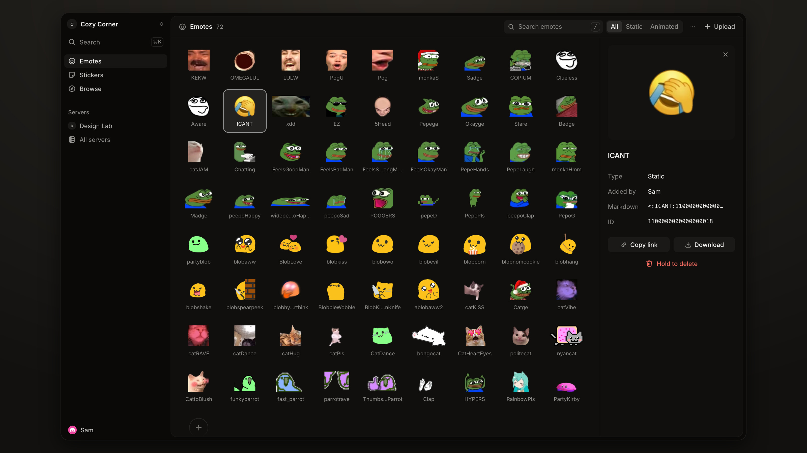

<div align="center">


# Emoteger

Manage your Discord server's emotes and stickers from the web.

</div>



## Features

- Upload, rename, copy, download and delete emotes and stickers
- Bulk delete that respects Discord's rate limits
- Browse emoji.gg, 7TV, Noto and Fluent, and add straight to your server
- Curated packs you can add in one go or download as a .zip
- Command menu on <kbd>⌘</kbd> <kbd>K</kbd>

Emoteger is self-hosted: you run it with your own Discord application and bot.

## Requirements

- [Bun](https://bun.sh) 1.4 or newer
- A Discord account that owns, administers, or has **Manage Expressions** in the servers you want to manage

`bun run` starts Next's CLI with Node if Node is on your `PATH` (and with Bun if it isn't), so if you have Node installed it needs to be 20.9 or newer.

## Discord setup

1. Open the [Discord Developer Portal](https://discord.com/developers/applications) and click **New Application**.
2. **OAuth2** page:
   - Copy the **Client ID** and **Client Secret** (reset it if it's hidden). These are `CLIENT_ID` and `CLIENT_SECRET`.
   - Under **Redirects**, add `http://localhost:3000/api/auth/callback`. Add your production URL too when you deploy, e.g. `https://emotes.example.com/api/auth/callback`. It has to match exactly.
3. **Bot** page:
   - Click **Reset Token** and copy it. This is `BOT_TOKEN`.
   - Leave **Requires OAuth2 Code Grant** off.
   - **Public Bot**: leave it on if other people should be able to add your bot to their servers. If it's off, only you (the application owner) can add it.
   - No privileged gateway intents are needed. Emoteger only uses the REST API.

Sign-in asks for the `identify` and `guilds` scopes: your profile, and the list of servers you're in, so Emoteger can show the ones you can manage.

The bot does the actual work, so it has to be in each server you manage. After signing in, servers without the bot are listed under "Not added yet" with an **Add** button that opens Discord's invite page. To invite it by hand instead:

```
https://discord.com/oauth2/authorize?client_id=YOUR_CLIENT_ID&scope=bot&permissions=8797166764032
```

That permission value is **Manage Expressions** plus **Create Expressions**, nothing else.

## Run it locally

```bash
git clone https://github.com/ChloeVPin/emoteger.git
cd emoteger
cp .env.example .env   # fill in the values, see the comments in the file
bun install
bun dev
```

Then open [localhost:3000](http://localhost:3000).

## Deploy

```bash
bun install --frozen-lockfile
bun run build
bun start              # listens on port 3000, set PORT to change it
```

- Set the same variables as in `.env.example`, either in a `.env` file next to the app or in your host's environment.
- Serve it over HTTPS. In production the session cookie is marked `Secure`, so sign-in won't stick over plain HTTP on anything but localhost.
- Behind a reverse proxy, set `APP_URL` to the public URL (e.g. `https://emotes.example.com`, no trailing slash). It's used to build the OAuth redirect, so it has to match the redirect you added in the Developer Portal.
- Changing `SESSION_SECRET` signs everyone out.
- The app writes a catalog cache to `.cache/` in the working directory (emoji.gg, Noto, Fluent indexes and similar). It's safe to delete, it'll be fetched again, but keep it on a persistent disk if you can: when a source is down, the last good copy is served instead of an error.

## Scripts

```bash
bun dev             # development server
bun run build       # production build
bun start           # production server
bun run typecheck   # generate route types, then type check
bun run packs       # rebuild src/data/packs.json from scripts/packs/spec.ts
```

`bun run packs` reads the emoji.gg, Noto and Fluent indexes from `.cache/`, so open Browse on each of those sources in a running dev server once before using it.

## Credits

Emotes from [emoji.gg](https://emoji.gg) and [7TV](https://7tv.app) belong to their creators. [Noto Animated Emoji](https://googlefonts.github.io/noto-emoji-animation/) by Google (CC BY 4.0). [Fluent Emoji](https://github.com/microsoft/fluentui-emoji) by Microsoft (MIT). Icons by [IconMCP](https://iconmcp.com) (MIT).

Not affiliated with Discord.

## License

[MIT](LICENSE)
